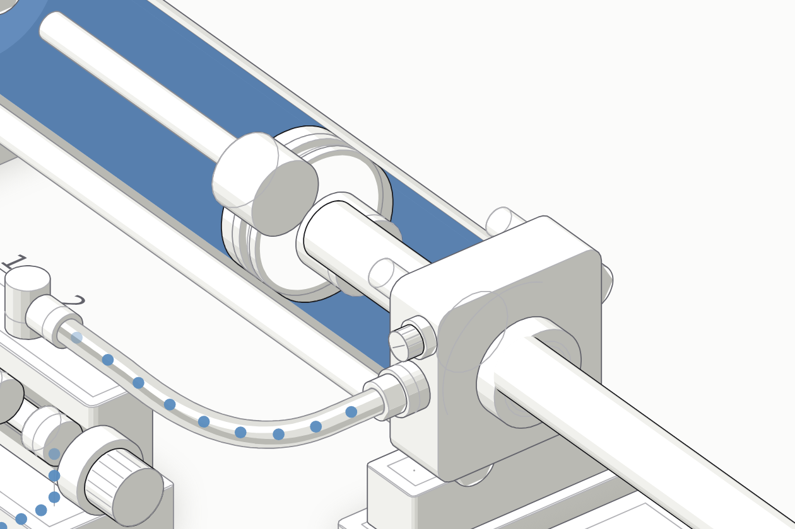

# Beispiel: doppeltwirkender Zylinder

Das erste fertige Bauteil der Sammlung **Pneumatik und E-Pneumatik** (FloG93/Pneu-EPneu), als Lesestoff für das erste eigene Bauteil. Live: <https://flog93.github.io/Pneu-EPneu/Zylinder-Doppeltwirkend/>

| Datei | gehört im Projekt nach | zeigt |
|---|---|---|
| `pneumatik.mjs` | `figur/pneumatik.mjs` | Rechenmodell: Flächen, Kräfte, Kammerdrücke, Kolbenbewegung, Dämpfung, Schieber |
| `pneumatik.test.mjs` | `figur/tests/` | 34 von Hand nachgerechnete Tests, auch „Bedingung statt Faustregel" |
| `build-zylinder.mjs` | `Zylinder-Doppeltwirkend/tests/tools/` | Geometrie, Schnittfenster, Schläuche, vier Tabellen, Laufzeit, Prüfhaken, `--audit`/`--apart` |
| `legende-zylinder.mjs` | `Zylinder-Doppeltwirkend/tests/tools/` | `LEGENDE`: zwölf Baugruppen mit Nummer, Name, Erklärsatz |
| `pruefe-zylinder.mjs` | `Zylinder-Doppeltwirkend/tests/tools/` | Zusatzprüfungen für den Browsertest |
| `seite.test.mjs` | `Zylinder-Doppeltwirkend/tests/` | Seitentest ohne Browser |
| `vorschau.svg`, `favicon.svg` | `Zylinder-Doppeltwirkend/` | Kachelbild und Symbol |
| `figur-README.md` | `Zylinder-Doppeltwirkend/README.md` | Bedienung, Farben, Zahlen, „Was die Figur nicht zeigt" |

An dieser Stelle laufen die Dateien nicht – ihre Importpfade setzen die Lage im Projekt voraus. In ein Projekt aus `anlegen.mjs` kopiert, bauen sie unverändert; das ist ein Teil der Probe dieses Skills (Audit, Zerlegen, Linienenden und Browsertest grün, auch mit anderen Medientönen).

`figur/tests/skill.test.mjs` im Repo Pneu-EPneu hält diese Kopien und die Vorlage im Gleichlauf mit dem Original.
