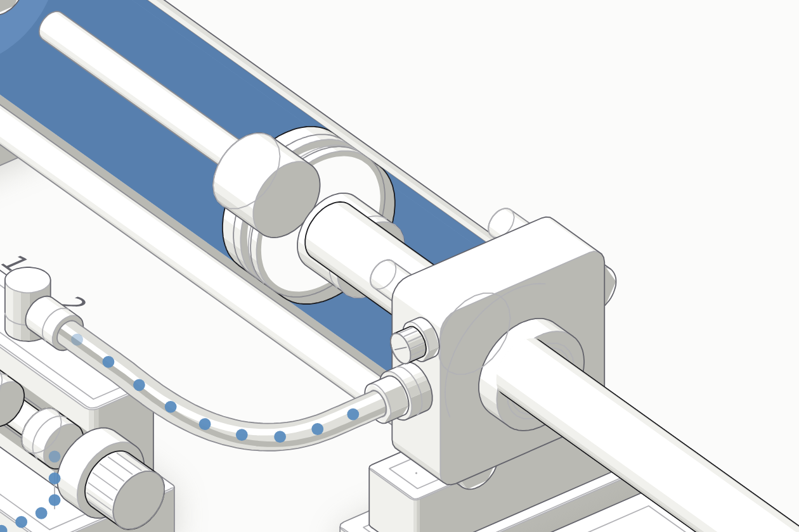

# Pneumatik und E-Pneumatik

Erklärte Bauteile für Auszubildende: jedes als interaktive isometrische Zeichnung, in der man sieht, was im Inneren passiert — direkt im Browser, ohne Installation.

**Online:** <https://flog93.github.io/Pneu-EPneu/> – die Übersichtsseite verlinkt alle Bauteile.

## Bauteile

| Rubrik | Bauteil | Was es zeigt | Online |
| --- | --- | --- | --- |
| **Aktoren** | **Doppeltwirkender Zylinder** | Schnitt durch einen Normzylinder nach ISO 15552 mit dem 5/2-Wegeventil, das ihn umschaltet. Die Druckluft strömt sichtbar: kräftiges Blau steht unter Druck, blasses ist Abluft. Knopf zum Zerlegen, Kraft nach F = p · A live gerechnet. | [Öffnen](https://flog93.github.io/Pneu-EPneu/Zylinder-Doppeltwirkend/) |
| **Wegeventile** | **5/2-Wegeventil** | Längsschnitt durch ein Ventil nach ISO 5599-1, Größe 1, in der Ebene des Schiebers. Kräftiges Blau steht unter Druck, blasses ist Abluft, das Schaltzeichen schaltet mit. Mono- und bistabil, Zeitlupe, Schieber von Hand, Knopf zum Zerlegen. | [Öffnen](https://flog93.github.io/Pneu-EPneu/Wegeventil-5-2/) |

[](https://flog93.github.io/Pneu-EPneu/Zylinder-Doppeltwirkend/)

Weitere Bauteile sind auf der Übersichtsseite als Kacheln angelegt und kommen nach und nach dazu: einfachwirkender Zylinder, Zylinder mit beidseitiger Kolbenstange, Teleskop- und Tandemzylinder, kolbenstangenloser Zylinder; 3/2-, 4/2- und 5/3-Wegeventile; Rückschlag-, Drosselrückschlag-, Schnellentlüftungs-, Wechsel- und Zweidruckventil; dazu die E-Pneumatik mit Magnetspule, Relais und Stromlaufplan.

## Für wen das gemacht ist

Für Auszubildende in Metall- und Elektroberufen, die Pneumatik lernen, und für die Ausbilderinnen und Ausbilder, die es ihnen beibringen. Die Seiten sind fürs Erklären am Beamer gebaut: **Hell ist der Startzustand**, und ein Kontrastregler spreizt die Töne, bis es auch in einem hellen Raum trägt. Jede Beschriftung hält mindestens 4,5:1 — nachgemessen, nicht geschätzt.

Jede angezeigte Zahl wird gerechnet, nicht behauptet. Wo ein Maß nicht aus Norm oder Katalog stammt, steht es in der README der Figur als Annahme.

## Aufbau

```
index.html                  Übersichtsseite (Startseite auf GitHub Pages)
Zylinder-Doppeltwirkend/    Bauteilseite
  index.html                erzeugt, nicht von Hand geschrieben
  favicon.svg, vorschau.svg (Kachelbild), README.md
  tests/tools/build-zylinder.mjs   Geometrie + vier Datentabellen
Wegeventil-5-2/             Bauteilseite
  index.html                erzeugt, nicht von Hand geschrieben
  favicon.svg, vorschau.svg (Kachelbild), README.md
  tests/tools/build-ventil.mjs     Geometrie + vier Datentabellen
figur/                      Gemeinsames Gerüst aller Figuren (keine index.html,
                            wird deshalb nicht veröffentlicht)
  pneumatik.mjs             Rechenmodell: Flächen, Kräfte, Drücke, Bewegung
  explode.mjs               Explosion: Wege, Federn, Tiefensortierung
  legende.mjs               Legende, Nummern, Erklärzeile
  ventil.mjs                Rechenmodell des Wegeventils: Schieber, Steuerkammern, Schaltzeit
  schaltzeichen.mjs         Schaltzeichen nach ISO 1219-1, das mitschaltet
  luft.mjs                  Luftwege, Partikel, Kammerfüllung, Blautöne
  seite.mjs                 Karte, Bedienleiste, Thema, Kontrast
shared/                     Design und Bedienelemente (aus dem Repo 3D-Druck)
.claude/skills/anatomy/     Zeichen-Kit (nicht veröffentlicht, nicht getestet)
.claude/skills/azubi-visualisierung/
                            Skill „Azubi Visualisierung": dieses Vorgehen für jedes Fach,
                            mit Vorlage, Anlege-Skript und dem Zylinder als Beispiel
docs/superpowers/specs/     Entwurf
.github/workflows/          Tests (tests.yml) und Veröffentlichung (pages.yml)
```

Veröffentlicht wird nach festen Regeln ([`pages.yml`](.github/workflows/pages.yml)):

- `index.html` im Hauptordner → <https://flog93.github.io/Pneu-EPneu/>
- jeder Ordner mit einer `index.html` → `https://flog93.github.io/Pneu-EPneu/<Ordner>/`
- `shared/` → `https://flog93.github.io/Pneu-EPneu/shared/`
- `tests/`, `docs/` und `README.md` eines Bauteils kommen nicht auf die Seite; `figur/` und `docs/` haben keine `index.html` und damit gar keine Seite.

### Neues Bauteil hinzufügen

1. Ordner anlegen, z. B. `Ventil-5-2/`, mit `tests/tools/build-ventil.mjs`. Das Skript liefert **nur** Geometrie und die vier Datentabellen; alles Allgemeine kommt aus `figur/`.
2. In `figur/kacheln.mjs` die Kachel auf `zustand: "fertig"` stellen, `vorschau.svg` in den Ordner legen und `npm run bau:uebersicht` laufen lassen.
3. Tests in `<Ordner>/tests/` ablegen und in `package.json` und [`tests.yml`](.github/workflows/tests.yml) eintragen.
4. `index.html` **erst committen, wenn die Seite vorzeigbar ist** — sie geht beim Push sofort live.

## GitHub Pages

Nichts einzurichten: der erste Lauf von [`pages.yml`](.github/workflows/pages.yml) schaltet GitHub Pages selbst ein (Quelle „GitHub Actions"). Klappt das nicht, sagt der Lauf, was unter **Settings → Pages** zu tun ist.

## Dasselbe für ein anderes Fach

Der Skill [`azubi-visualisierung`](.claude/skills/azubi-visualisierung/SKILL.md) hält fest, wie diese Sammlung entstanden ist – Fragen, Reihenfolge, Prüftore, Fallstricke – und legt mit einem Befehl ein neues Projekt an, z. B. für Hydraulik:

```bash
node .claude/skills/azubi-visualisierung/scripts/anlegen.mjs ../Hydraulik projekt.json
```

`figur/tests/skill.test.mjs` hält die Kopien im Skill im Gleichlauf mit diesem Repo.

## Lokal starten und testen

Alles ist reines HTML/CSS/JavaScript ohne Build-Schritt. Wegen der ES-Module braucht es einen kleinen Webserver:

```bash
python3 -m http.server 8080   # oder: npm start
# Übersicht: http://localhost:8080/
```

```bash
npm test                      # Rechenmodell, Kontrast, Bauteile
```

```bash
npm run bau:zylinder          # erzeugt Zylinder-Doppeltwirkend/index.html neu
```

```bash
npm run pruef:zylinder        # prüft die Geometrie in Ruhe und zerlegt
```

```bash
npm run bau:ventil            # erzeugt Wegeventil-5-2/index.html neu
npm run pruef:ventil          # prüft dort Geometrie in Ruhe und zerlegt
```
